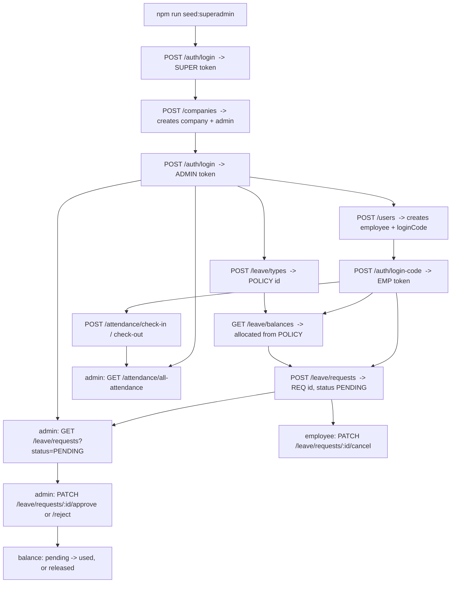

# API Testing Runbook

End-to-end manual test of every endpoint, in dependency order. Do the steps top to
bottom — each one produces a token or an id the next one needs.

Base URL: `http://localhost:5000/api`

---

## 0. Prerequisites

- [ ] MongoDB running, `.env` has `PORT`, `MONGO_URI`, `JWT_SECRET`
- [ ] `npm run dev` is up
- [ ] `curl http://localhost:5000/api/health` returns `{ "message": "Server is running" }`

Tip: after each login, export the token so you can paste `$SUPER` / `$ADMIN` / `$EMP`
into the next call.

---

## How the APIs connect



**Two frontends, one backend.** The employee phone app calls the `EMP`-token
endpoints; the admin web panel calls the `ADMIN`-token endpoints. Role in the JWT
decides what each call returns.

| Area | Employee app (`login-code`) | Admin panel (`login`) |
|---|---|---|
| Attendance | check-in, check-out, my-attendance | all-attendance |
| Leave types | — | create / list / update / delete |
| Leave balance | GET /leave/balances (own) | *(none yet — see gaps)* |
| Leave requests | create, list (own), cancel | list (all), approve, reject |

---

## 1. Auth

### 1.1 Seed + superadmin login
- [ ] `npm run seed:superadmin`
```bash
curl -X POST http://localhost:5000/api/auth/login \
  -H "Content-Type: application/json" \
  -d '{"email":"superadmin@gmail.com","password":"Super@123"}'
```
Expect `200 { token, user }`. Save `token` as **SUPER**.
- [ ] wrong password → `401 "Invalid credentials"`
- [ ] missing field → `400 "email and password are required"`

---

## 2. Companies  (superadmin only)

### 2.1 Create a company + its admin
```bash
curl -X POST http://localhost:5000/api/companies \
  -H "Content-Type: application/json" -H "Authorization: Bearer $SUPER" \
  -d '{"companyName":"Acme Inc","adminName":"Alice Admin","adminEmail":"alice@acme.com","adminPassword":"Admin@123"}'
```
Expect `201 { company, admin }`.
- [ ] same company name again → `409 "Company already exists"`
- [ ] missing field → `400`
- [ ] call it with **ADMIN** token instead of SUPER → `403 "Forbidden"`

### 2.2 Admin login
```bash
curl -X POST http://localhost:5000/api/auth/login \
  -H "Content-Type: application/json" \
  -d '{"email":"alice@acme.com","password":"Admin@123"}'
```
Save `token` as **ADMIN**.

---

## 3. Users  (admin only, scoped to admin's company)

### 3.1 Create an employee
```bash
curl -X POST http://localhost:5000/api/users \
  -H "Content-Type: application/json" -H "Authorization: Bearer $ADMIN" \
  -d '{"name":"Bob Employee","phone":"9999999999","designation":"Dev","department":"Engineering"}'
```
Expect `201 { user, loginCode }`. **Save `loginCode`** (6 digits) — shown only once.
- [ ] missing `name` → `400 "name is required"`

### 3.2 List employees
```bash
curl http://localhost:5000/api/users -H "Authorization: Bearer $ADMIN"
```
Expect `200 { users: [ ...role user only... ] }`.

### 3.3 Update an employee
```bash
curl -X PUT http://localhost:5000/api/users/<USER_ID> \
  -H "Content-Type: application/json" -H "Authorization: Bearer $ADMIN" \
  -d '{"designation":"Senior Dev"}'
```
Expect `200 { user }` with the new designation.
- [ ] bad id → `404 "User not found"`

### 3.4 Delete an employee
```bash
curl -X DELETE http://localhost:5000/api/users/<USER_ID> -H "Authorization: Bearer $ADMIN"
```
Expect `200 "User deleted successfully"`. *(Recreate one afterwards for the rest of the tests.)*

### 3.5 Employee login
```bash
curl -X POST http://localhost:5000/api/auth/login-code \
  -H "Content-Type: application/json" \
  -d '{"code":"<loginCode>"}'
```
Expect `200 { token, user }`. Save `token` as **EMP**.
- [ ] wrong code → `401 "Invalid code"`

---

## 4. Attendance

### 4.1 Employee checks in
```bash
curl -X POST http://localhost:5000/api/attendance/check-in -H "Authorization: Bearer $EMP"
```
Expect `201 { message: "Checked in", record }` with `checkInTime`, `status: "present"`.
- [ ] call again → `400 "Already checked in today"`
- [ ] call with **ADMIN** token → `403` (route is `requireRole("user")`)

### 4.2 Employee checks out
```bash
curl -X POST http://localhost:5000/api/attendance/check-out -H "Authorization: Bearer $EMP"
```
Expect `200` with `checkOutTime` and `totalHours` filled.
- [ ] call again → `400 "Already checked out today"`
- [ ] (fresh user who never checked in) check-out → `400 "checking first"`

### 4.3 Employee views own attendance
```bash
curl "http://localhost:5000/api/attendance/my-attendance" -H "Authorization: Bearer $EMP"
curl "http://localhost:5000/api/attendance/my-attendance?date=2020-01-01" -H "Authorization: Bearer $EMP"
```
Today → `200 { record }`. Old date → `404 "Attendance record not found"`.

### 4.4 Admin views all attendance
```bash
curl "http://localhost:5000/api/attendance/all-attendance" -H "Authorization: Bearer $ADMIN"
curl "http://localhost:5000/api/attendance/all-attendance?from=2026-01-01&to=2026-12-31&userId=<USER_ID>" \
  -H "Authorization: Bearer $ADMIN"
```
Expect `200 { attendance: [...] }`, `userId` populated with name/designation/department, newest first.
- [ ] call with **EMP** token → `403`

---

## 5. Leave types  (admin only)

### 5.1 Create a policy
```bash
curl -X POST http://localhost:5000/api/leave/types \
  -H "Content-Type: application/json" -H "Authorization: Bearer $ADMIN" \
  -d '{"name":"Annual Leave","yearlyQuota":12,"accrualType":"ANNUAL","accrualAmount":0,
       "allowHalfDay":true,"requiresDocument":false,"minimumNoticeDays":0,"maximumConsecutiveDays":10}'
```
Expect `201 { policy }`. **Save `policy._id`** as **POLICY**.
- [ ] missing `name` → `400 "name is required"`
- [ ] same name again → `400 "Leave policy with this name already exists"`

### 5.2 List policies
```bash
curl http://localhost:5000/api/leave/types -H "Authorization: Bearer $ADMIN"
```
Expect `200` array of active policies.

### 5.3 Update a policy
```bash
curl -X PUT http://localhost:5000/api/leave/types/<POLICY> \
  -H "Content-Type: application/json" -H "Authorization: Bearer $ADMIN" \
  -d '{"maximumConsecutiveDays":5}'
```
Expect `200` updated policy. Bad id → `404`.

### 5.4 Delete a policy
Skip for now — you need this policy for section 7. Test later with a throwaway policy:
```bash
curl -X DELETE http://localhost:5000/api/leave/types/<throwaway id> -H "Authorization: Bearer $ADMIN"
```
Expect `200 "Leave policy deleted successfully"`.

---

## 6. Leave balance

### 6.1 Employee views balance
```bash
curl http://localhost:5000/api/leave/balances -H "Authorization: Bearer $EMP"
```
Expect `200` array. For the Annual Leave policy:
```json
{ "allocated": 12, "carryForward": 0, "manualAdjustment": 0,
  "used": 0, "pending": 0, "available": 12 }
```
- [ ] `allocated` = the policy's `yearlyQuota`
- [ ] `available` = allocated + carryForward + manualAdjustment − used − pending

*(The row is created on first read — this call is also what seeds the balance.)*

---

## 7. Leave requests  — the core flow

### 7.1 Employee applies
```bash
curl -X POST http://localhost:5000/api/leave/requests \
  -H "Content-Type: application/json" -H "Authorization: Bearer $EMP" \
  -d '{"leaveTypeId":"<POLICY>","startDate":"2026-10-05","endDate":"2026-10-07","reason":"Family trip"}'
```
Expect `201`, `status: "PENDING"`, `totalDays: 3`. **Save the request `_id`** as **REQ**.
- [ ] re-check 6.1 → `pending: 3`, `available: 9` (days are *held*, not spent)

### 7.2 Employee lists own requests
```bash
curl http://localhost:5000/api/leave/requests -H "Authorization: Bearer $EMP"
```
Expect array with just REQ. An employee never sees other people's requests.

### 7.3 Admin lists pending (approvals inbox)
```bash
curl "http://localhost:5000/api/leave/requests?status=PENDING" -H "Authorization: Bearer $ADMIN"
```
Expect every pending request in the company (no per-user filter for admin).

### 7.4 Admin approves
```bash
curl -X PATCH http://localhost:5000/api/leave/requests/<REQ>/approve -H "Authorization: Bearer $ADMIN"
```
Expect `status: "APPROVED"`, `approvedBy`, `approvedAt` set.
- [ ] re-check 6.1 → `pending: 0`, `used: 3`, `available: 9` (hold became a spend)
- [ ] approve again → `400 "Request is already APPROVED"`
- [ ] approve with **EMP** token → `403`

### 7.5 Admin rejects  (use a second request)
Apply again as EMP for `2026-11-10` → `2026-11-11` (2 days), save id as **REQ2**.
```bash
curl -X PATCH http://localhost:5000/api/leave/requests/<REQ2>/reject \
  -H "Content-Type: application/json" -H "Authorization: Bearer $ADMIN" \
  -d '{"reason":"Release week"}'
```
Expect `status: "REJECTED"`, `rejectionReason` set.
- [ ] 6.1 → the 2 held days are released; `LeaveDay` rows for REQ2 are gone

### 7.6 Employee cancels  (use a third request)
Apply again as EMP for a future date, save id as **REQ3**.
```bash
curl -X PATCH http://localhost:5000/api/leave/requests/<REQ3>/cancel \
  -H "Content-Type: application/json" -H "Authorization: Bearer $EMP" \
  -d '{"reason":"Plans changed"}'
```
Expect `status: "CANCELLED"`, `cancelledAt` set. Held days released.
- [ ] cancel an already-started approved leave → `400 "Cannot cancel leave that has already started"`

---

## 8. Validation / error matrix  (leave request create)

| Input | Expected |
|---|---|
| `startDate` > `endDate` | `400 "Start date cannot be after end date"` |
| missing `leaveTypeId` / dates / `reason` | `400 "Missing required fields"` |
| `leaveTypeId` not in company | `404 "Leave policy not found"` |
| days requested > `available` | `400 "Insufficient leave balance"` |
| overlaps an existing PENDING/APPROVED request | `409 "You already have leave in this period"` |
| half-day (`dayType:"FIRST_HALF"`, single day) when policy `allowHalfDay:false` | `400 "Half-day is not allowed..."` |
| range longer than `maximumConsecutiveDays` | `400 "Exceeds maximum consecutive days..."` |
| `startDate` inside `minimumNoticeDays` window | `400 "Requires N days notice"` |
| policy `requiresDocument:true`, no `attachmentUrl` | `400 "Supporting document required..."` |
| no / bad `Authorization` header | `401 "No token provided"` / `401 "Invalid or expired token"` |

Run the balance-math unit check any time:
```bash
npx ts-node src/scripts/checkBalanceDelta.ts   # -> "balanceDelta ok"
```

---

## 9. Known gaps (not bugs — not built yet)

- No `GET /leave/balances/:userId` for admin — admin can't see an employee's remaining days.
- No manual balance adjustment endpoint (the `manualAdjustment` field is unused).
- No carry-forward job at year rollover.
- `getDateRange` counts weekends/holidays as leave.
- No global error-handling middleware — an unhandled DB error returns a default 500 page.
- Dec→Jan spanning request only hits one leave year's balance.
